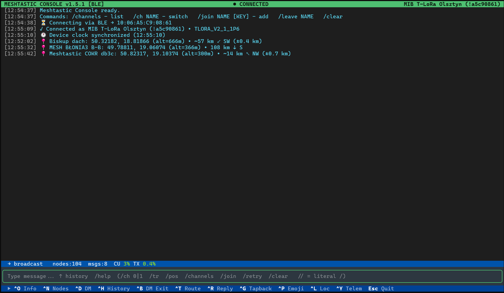

# Meshtastic Console

A terminal chat client for [Meshtastic](https://meshtastic.org) radios — connect over **Bluetooth LE** or **WiFi/TCP** and chat on channels and in direct messages from a fast keyboard-driven TUI built with [Textual](https://textual.textualize.io).



## Features

- **Channels** — list, switch, join (public, base64/hex or random key) and leave channels
- **Direct messages with PKI** — automatic key exchange, delivery status (✓ relayed, ✓✓ delivered), smart automatic resend and `/retry`
- **DM archive** — every DM is kept locally and browsable (`Ctrl+H`)
- **Replies and tapbacks** — reply to a message or react with an emoji
- **Emoji picker** — categories, search (English and Polish keywords), recently used
- **Node list** — hops, distance, SNR, battery, last seen; search by name, short name, ID or hardware; DM, traceroute, NODEINFO, map, LocalStats and device metrics right from the list
- **Traceroute** — pick a node from a filterable list or `/tr NAME`
- **Location** — send typed coordinates or one of the recent ones
- **Radio health** (`Ctrl+O`) — channel utilization and TX airtime with a 1-hour trend, RX/TX counters, bad/duplicate packets, relay statistics, noise floor and "who relays to me"
- **MQTT status** — the device info (`Ctrl+O`) shows whether MQTT is on, which channels go up/down, and warns when it can't work (no network, no channel, phone proxy); `/mqtt` gives server, topic and packets received via MQTT
- **Telemetry view** — show all raw packets, optionally logged to a file
- **Shell-like input** — `↑`/`↓` history kept between runs
- **Calm scroll-back** — scroll up to read older messages; the view stays put and new lines are counted in the status bar
- **Built-in help** — `/help` lists every command and shortcut

## Requirements

- Python 3.10+
- A Meshtastic device with Bluetooth or WiFi enabled (firmware 2.7.x recommended)
- Windows, macOS or Linux (notification sounds on Windows and macOS)

## Installation

```bash
git clone https://github.com/Alver-AI/MeshConsole.git
cd MeshConsole
python -m venv .venv
# Windows:  .venv\Scripts\activate
# macOS/Linux:  source .venv/bin/activate
pip install -r requirements.txt
```

## Usage

```bash
python mesh_console.py --tcp 192.168.1.100      # WiFi: device IP address
python mesh_console.py --tcp meshtastic.local   # WiFi: mDNS hostname

python mesh_console.py                          # BLE: auto-detect a paired device
python mesh_console.py --scan                   # BLE: list devices in range
python mesh_console.py --ble <address_or_uuid>  # BLE: connect to a specific device

python mesh_console.py --telemetry --log telem.log   # show and log raw packets
```

Type `/help` in the app for the full reference.

## Commands

| Command | Description |
|---|---|
| `/help` | All commands and shortcuts |
| `/ch` · `/ch NAME` · `/ch N` | Show / switch the channel you write on |
| `/channels` | List the device's channels |
| `/join NAME [KEY]` | Add a channel (`AQ==`/`default` = public, base64, `0x`-hex, `random`, `none`) |
| `/leave NAME` · `/leave N` | Remove a secondary channel |
| `/tr` · `/tr NAME` · `/tr !id` | Traceroute |
| `/pos` · `/pos LAT, LON [, ALT]` | Send location |
| `/retry` | Resend the last DM |
| `/mqtt` | MQTT status: server, topic, channels, packets received via MQTT |
| `/telem [on\|off]` | Toggle raw telemetry |
| `/clear` | Clear the screen |
| `//text` | Send text that starts with `/` |

## Keyboard shortcuts

| Key | Action | Key | Action |
|---|---|---|---|
| `Ctrl+N` | Node list | `Ctrl+D` | Start a DM |
| `Ctrl+H` | DM archive | `Ctrl+B` | Leave DM / reply mode |
| `Ctrl+R` | Reply to a message | `Ctrl+G` | Tapback (reaction) |
| `Ctrl+P` | Insert emoji | `Ctrl+T` | Traceroute |
| `Ctrl+L` | Send location | `Ctrl+O` | Device info / radio health |
| `Ctrl+Y` | Telemetry on/off | `F1` | Focus the input line |
| `↑` / `↓` | Input history | `PgUp` / `PgDn` | Scroll messages |
| `End` (twice) | Jump to newest message | `Esc` | Quit (asks first) |

In the node list: `Enter`/`d` DM · `t` traceroute · `i` NODEINFO · `m` map · `s` LocalStats · `b` device metrics · `/` or `Ctrl+F` search (`Esc` clears).

## Local data

Meshtastic Console stores its data **next to the script**. These files may contain private messages and locations — they are listed in `.gitignore`, keep them out of version control.

| File | Contents |
|---|---|
| `mesh_nodes.json` | Known nodes, names, keys |
| `mesh_dm_archive.jsonl` | Direct-message archive |
| `mesh_locations.json` | Recently sent locations |
| `mesh_neighbours.json` | Neighbour / relay statistics |
| `mesh_emoji_recent.json` | Recently used emoji |
| `mesh_input_history.json` | Input line history |

## License

[GPL-3.0-or-later](LICENSE). Meshtastic Console uses the [Meshtastic Python library](https://github.com/meshtastic/python), which is also GPL-3.0.

Meshtastic® is a registered trademark of Meshtastic LLC. This is an independent community project, not affiliated with or endorsed by Meshtastic LLC.
